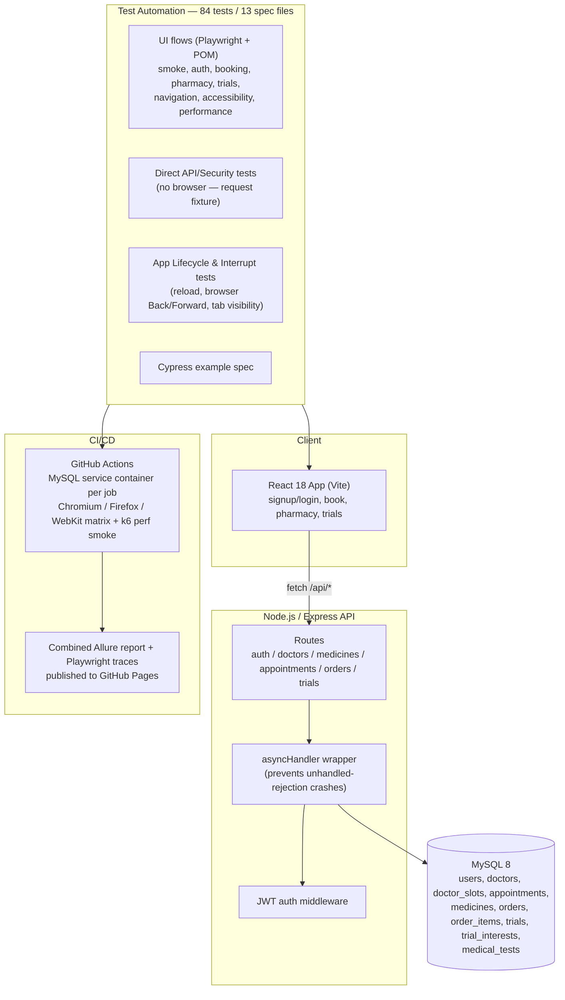

# Meridian Health — Full-Stack QA Automation Portfolio

A complete healthcare demo application — React frontend, Express/MySQL backend — paired
with a from-scratch Playwright automation suite covering signup/login, telehealth
booking, pharmacy checkout, clinical trial matching, direct API/security testing, and
app-lifecycle behavior. Built end-to-end as a QA automation portfolio piece: not just
tests bolted onto someone else's app, but the app, the database schema, the API, and
the test suite all built and debugged together, including a real production bug (a
server crash under error conditions), a genuine CI-only Playwright/DOM race condition,
a real UX gap in browser navigation, and a real input-validation bug — all found,
root-caused, and either fixed with a regression test or documented along the way.


[](https://github.com/REZAULKARIM2024/MeridianHealth-test-automation/actions/workflows/ci.yml)

[](https://rezaulkarim2024.github.io/MeridianHealth-test-automation/)


**A 30-second look at the app** — signing up, booking a doctor's appointment, adding a
prescription item to the pharmacy cart, and getting matched to a clinical trial, live:


## Table of Contents

- [Overview](#overview)
- [Architecture](#architecture)
- [Features](#features)
- [Tech Stack](#tech-stack)
- [Prerequisites](#prerequisites)
- [Installation](#installation)
- [Configuration](#configuration)
- [Running the Application](#running-the-application)
- [Bulk Demo Data (Optional)](#bulk-demo-data-optional)
- [Project Structure](#project-structure)
- [Database Overview](#database-overview)
- [Testing](#testing)
- [Form Validation Report](#form-validation-report)
- [Test Reporting (Allure)](#test-reporting-allure)
- [CI/CD Pipeline](#cicd-pipeline)
- [Cross-Browser CI Matrix](#cross-browser-ci-matrix)
- [Selenium + Playwright](#selenium--playwright)
- [Performance Smoke (k6)](#performance-smoke-k6)
- [Docker Compose & Security Scan](#docker-compose--security-scan)
- [Test Automation Design Notes](#test-automation-design-notes)
- [Known Issues & QA Findings](#known-issues--qa-findings)
- [Roadmap](#roadmap)
- [License](#license)
- [Contact](#contact)

## Overview

Meridian Health is a small telehealth-style demo app: users sign up, book an
appointment with a doctor, order medicine from a pharmacy (with prescription-upload
gating on Rx items), and get matched to clinical trials by age and condition. Every
flow is backed by a real MySQL database through a real Express API — nothing is
mocked or stubbed, so the automation suite is exercising the same code path a real
user would hit.

The point of the project is the QA process as much as the app itself: **84 automated
Playwright tests across 13 spec files** — UI flows, direct API/security testing, and
app-lifecycle/browser-navigation behavior — driven through a Page Object Model,
running green in CI on every push. A real production bug, a real CI-only flake, a real
UX gap, and a real input-validation bug were all root-caused and fixed — with
regression tests checked in for each — rather than papered over (see
[Known Issues & QA Findings](#known-issues--qa-findings) and the standalone
[Form Validation Report](#form-validation-report)).

## Architecture



## Features

### Core App
- Signup / login with JWT auth and server-side password hashing.
- Telehealth booking — pick a doctor, pick a time slot, confirm an appointment; booked
  appointments persist to MySQL and show up on the home dashboard.
- Pharmacy — search/browse medicines, add to cart, adjust quantity, checkout with
  shipping + card details; prescription upload is required before checkout completes
  for any Rx-flagged item; out-of-stock items can't be added.
- Clinical trial matching — enter age + condition, get matched trials by eligibility
  range, express interest (idempotent — re-expressing interest doesn't error).
- Responsive mobile/desktop toggle with matching nav patterns (bottom tab bar vs. side
  nav) for the same screens.

### Backend Hardening
- Every route wrapped in an `asyncHandler` so a database error becomes a clean `500`
  JSON response instead of crashing the whole Node process — found during automation
  runs when a real error (bad DB credentials) was taking down the entire server and
  failing every subsequent test in the run, not just the one that hit the error.
- `auth.js` validates `name` length (≤120 chars) before it ever reaches the database —
  found via live testing that a too-long name previously fell through to a raw
  `500` (`ER_DATA_TOO_LONG`) instead of a clean `400`. See
  [Form Validation Report](#form-validation-report).
- Process-level `unhandledRejection` / `uncaughtException` listeners as a second line
  of defense on top of the per-route wrapper.

## Tech Stack

| Layer | Technology |
|---|---|
| Frontend | React 18, Vite, Tailwind CSS |
| Backend | Node.js, Express, JWT auth |
| Database | MySQL 8, `mysql2` connection pool |
| E2E Tests | Playwright (TypeScript), Page Object Model |
| Test Reporting | Allure (`allure-playwright`) |
| Performance | k6 smoke test with SLO thresholds (nightly + on every push) |
| Security | `helmet` response headers on the API, nginx security headers on the SPA, OWASP ZAP baseline scan in CI |
| Containers | Docker Compose full stack (MySQL 8 + Express API + nginx-served SPA) |
| CI/CD | GitHub Actions — MySQL service container, cross-browser matrix (Chromium / Firefox / WebKit), Allure + Playwright HTML reports (with traces) published to GitHub Pages |
| Also included | A Cypress example spec, for comparison |
| Dev tooling | `concurrently` (run API + frontend together), `vite preview` for a production-build test target |

## Prerequisites

- Node.js 18+ and npm
- MySQL 8.x running locally (or reachable over the network)
- A modern browser (Playwright installs its own Chromium/Firefox/WebKit binaries)

## Installation

1. **Clone the repository**
   ```bash
   git clone https://github.com/REZAULKARIM2024/MeridianHealth-test-automation.git
   cd MeridianHealth-test-automation
   ```
2. **Create the MySQL app user and database** (run once, as root):
   ```sql
   CREATE USER 'meridian'@'%' IDENTIFIED BY 'meridian_dev_pw';
   CREATE DATABASE IF NOT EXISTS meridian_health;
   GRANT ALL PRIVILEGES ON meridian_health.* TO 'meridian'@'%';
   FLUSH PRIVILEGES;
   ```
3. **Install dependencies** (root app + server, from the project root):
   ```bash
   npm install
   npm install --prefix server
   ```
4. **Install Playwright's browser binaries** (first time only):
   ```bash
   npx playwright install
   ```

## Configuration

Copy `server/.env.example` to `server/.env` and fill in real values:

```bash
DB_HOST=127.0.0.1
DB_PORT=3306
DB_USER=meridian
DB_PASSWORD=meridian_dev_pw
DB_NAME=meridian_health
JWT_SECRET=change_this_to_a_long_random_string
PORT=4000
CORS_ORIGIN=http://localhost:5173
```

Generate a real `JWT_SECRET` with:
```bash
node -e "console.log(require('crypto').randomBytes(48).toString('hex'))"
```

## Running the Application

**One-click setup + test run (Windows):** double-click `run-tests.bat`. It creates
`server/.env` with working local defaults if missing, installs dependencies, frees any
stuck ports, initializes the database schema + seed data, builds the app, and runs the
full Playwright suite.

**Manual, step by step:**
```bash
# 1. Seed the database (schema + demo doctors/medicines/trials)
npm run db:init --prefix server

# 2. Run the app in dev mode (API + Vite dev server together)
npm run dev:full
# open http://localhost:5173
```

## Bulk Demo Data (Optional)

For a richer demo, load a large synthetic dataset on top of the base seed:

```bash
mysql -u meridian -pmeridian_dev_pw meridian_health < server/src/bulk_seed.sql
mysql -u meridian -pmeridian_dev_pw meridian_health < server/src/more_medicines.sql
mysql -u meridian -pmeridian_dev_pw meridian_health < server/src/medical_tests.sql
```

This adds:

| Data | Count | Notes |
|---|---|---|
| Patients (`users`) | 500 | Unique names/emails (`patient1@meridianmail.test` … `patient500@…`); all share the password `Demo1234!` |
| Doctors | 300 | Across 25 medical specialties, 4 time slots each (1,200 slots total) |
| Medicines | 1,500 | Realistic generic-drug-name/strength/form combinations, all unique, ~1/3 Rx-required |
| Medical tests | 200 | New `medical_tests` table — diagnostic/lab tests across Blood, Imaging, Cardiac, Urine/Stool, Pulmonary, and Other categories |

All three files use `INSERT IGNORE`, so they're safe to re-run without creating
duplicates. Every row was validated by actually running the SQL against a real MySQL
instance and checking row counts/uniqueness before being committed.

**Note:** `medical_tests` is currently data-only — there's no app UI or API route for
it yet (no "Tests" tab, no booking flow). It's ready for that feature to be built on
top of it.

## Project Structure

```
meridian-tests/
  src/
    MeridianHealthApp.jsx   React app — all screens, all data-testid attrs
    api.js                  fetch client, proxies /api/* to the backend
    main.jsx, index.css     Vite entry point + Tailwind
  server/
    src/
      schema.sql            8 tables (see Database Overview)
      seed.sql               idempotent demo data — 4 doctors, 6 medicines, 4 trials
      bulk_seed.sql          500 patients, 300 doctors, 500 medicines (optional)
      more_medicines.sql     +1000 more medicines, bringing the catalog to 1500 (optional)
      medical_tests.sql      new medical_tests table + 200 diagnostic tests (optional)
      initDb.js               `npm run db:init` entry point
      db.js                  mysql2 pool
      asyncHandler.js        wraps every route so DB/API errors can't crash the server
      middleware/auth.js     JWT bearer-token verification (helmet security headers in index.js)
      routes/                auth, doctors, medicines, appointments, orders, trials
      index.js               Express app, listens on :4000
    .env.example
  tests/                     Playwright spec files (TypeScript), 84 tests / 13 files
  pages/                     Page Object Model — AuthPage, NavPage, BookPage,
                              PharmacyPage, TrialsPage
  playwright.config.ts       primary config — serial workers, retries, HTML + Allure reporters
  playwright.dev.config.ts   alternate config for fast dev-mode iteration
  run-tests.bat              one-click Windows setup + test runner
  vite.config.js             dev + preview proxy: /api -> localhost:4000
  .github/workflows/ci.yml   GitHub Actions pipeline (Chromium/Firefox/WebKit matrix)
  .github/workflows/perf.yml k6 performance smoke with SLOs
  .github/workflows/security.yml            Docker Compose stack + OWASP ZAP baseline scan
  .github/workflows/ai-test-design.yml      manual workflow: qa-test-case-agent draft test cases
  perf/                      k6 script + SLO documentation
  ai-test-design/            user stories + notes on AI-assisted test design
  docker-compose.yml         full stack in one command (db + api + web)
  Dockerfile.web, nginx.conf SPA image: Vite build served by nginx, /api proxied, security headers
  server/Dockerfile          API image
  FORM_VALIDATION_REPORT.md  senior-QA-level form validation review, live-verified
```

## Database Overview

| Table | Purpose |
|---|---|
| `users` | Signup/login accounts |
| `doctors` | Bookable doctors (name, specialty, rating) |
| `doctor_slots` | Available time slots per doctor; `UNIQUE (doctor_id, slot_label)` so repeated seeding cannot create duplicates (`db:init` migrates older databases and removes existing duplicates) |
| `appointments` | Booked appointments, linked to `users` + `doctors` |
| `medicines` | Pharmacy catalog, incl. Rx-required flag and stock |
| `orders` / `order_items` | Pharmacy checkout, order line items |
| `trials` | Clinical trials with eligibility age range + condition |
| `trial_interests` | User interest expressions, unique per (user, trial) |
| `medical_tests` | Diagnostic/lab test catalog (data-only — see [Bulk Demo Data](#bulk-demo-data-optional)) |

## Testing

```bash
npm run test:e2e -- --project=chromium   # one browser (fastest)
npm run test:e2e:cross                    # Chromium + Firefox + WebKit
```

This runs the `pretest:e2e` hook first (`vite build`), so tests run against a real
production build served via `vite preview` — not the dev server — which removes
first-request compile latency as a source of flaky timing.

**84 tests across 13 spec files, currently 100% passing in CI:**

| File | Covers |
|---|---|
| `smoke.spec.ts` | App loads, signup, logout, re-login, nav tabs |
| `auth.spec.ts` | Client + server-side validation, negative/data-driven cases |
| `booking.spec.ts` | Happy path, per-doctor data-driven booking, dashboard reflection |
| `pharmacy.spec.ts` | Search, cart, Rx gating, checkout validation, price totals |
| `trials.spec.ts` | Matching, boundary ages, interest expression, empty states |
| `navigation.spec.ts` | Tab routing, back navigation, mobile/desktop layouts |
| `accessibility.spec.ts` | Keyboard navigation, accessible names, focus visibility |
| `performance_and_device.spec.ts` | Load time budget, network-drop tolerance, data reset |
| `api.spec.ts` | Direct HTTP tests against the real backend — signup/login/doctors/medicines/booking/trial matching, plus the `name`-length boundary (`API-11`/`API-12`) |
| `security.spec.ts` | Unauthorized access, tampered/forged JWTs, SQL-injection and XSS safety, security response headers |
| `story-criteria.spec.ts` | Acceptance criteria of the booking and pharmacy-Rx user stories (error messages, optional fields, per-user data isolation) |
| `lifecycle.spec.ts` | Session behavior across a reload; browser Back/Forward and tab-visibility "interrupt" tests |
| `debug-booking.spec.ts` | A diagnostic spec (network/console dump) used during development to isolate a timing issue in the booking flow — kept in the suite as a template for future debugging |

Config highlights (`playwright.config.ts`):
- `workers: 1` — serial execution; this local stack (single Node process + single MySQL
  instance) showed real, reproducible contention at higher worker counts, not flaky
  noise. CI runs the same way for consistency with local runs.
- `retries: 2` on top of the fixes below — a safety net for real machine-load variance,
  not a substitute for fixing root causes.
- `expect.timeout: 20_000` — raised from Playwright's 10s default after observing this
  project's full-suite run time vary noticeably across different machines and background
  load.
- `reporter: [["html"], ["allure-playwright"], ["list"]]` — HTML report for local runs,
  Allure results for the richer CI report (see below).

## Form Validation Report

[`FORM_VALIDATION_REPORT.md`](./FORM_VALIDATION_REPORT.md) is a standalone,
senior-QA-level review of every form in the app — signup/login, booking, pharmacy
checkout, and trial matching — comparing client-side and server-side validation rule
by rule, field by field. Every claim in it was verified by actually running the real
server against a live MySQL instance and issuing real HTTP requests, not inferred from
reading the code alone. It's what surfaced the `name`-length bug documented below and
in `API-11`/`API-12`.

## Test Reporting (Allure)

```bash
npm run test:e2e            # writes raw results to allure-results/
npm run allure:generate     # builds the static report into allure-report/
npm run allure:open         # serves it locally and opens your browser
```

Allure's results are written to `allure-results/` on every test run (via the
`allure-playwright` reporter), separate from Playwright's own built-in HTML report.
Because the generated report is a client-side app that fetches its data as JSON,
**open it over `http://`, not by double-clicking `index.html`** — `npm run allure:open`
handles that for you, or serve `allure-report/` with any static file server.

CI generates and uploads this same report as a build artifact on every push — see
[CI/CD Pipeline](#cicd-pipeline).

## CI/CD Pipeline

Two workflows run on every push/PR to `main`:

**`ci.yml` - end-to-end tests, as a Chromium / Firefox / WebKit matrix.** Each browser is
its own parallel job (`fail-fast: false`):

1. Spins up a real **MySQL 8 service container** and creates the `meridian` app user.
2. Installs root + server dependencies, writes a CI-specific `server/.env`.
3. Initializes the database schema + seed data (`npm run db:init`).
4. Installs only that job's Playwright browser.
5. Runs the full 84-test suite against a production build
   (`npm run test:e2e -- --project=<browser>`).
6. Uploads per-browser artifacts, even on failure: the Playwright HTML report (traces),
   raw Allure results, and - on failure - raw `test-results/` (screenshots, traces,
   `error-context.md` per failure; this is what was used to root-cause the CI-only race
   and the browser-history finding described below).

A final `report` job merges the three browsers into one Allure report and publishes it,
with the per-browser Playwright reports, to GitHub Pages - see
[Cross-Browser CI Matrix](#cross-browser-ci-matrix).

**`perf.yml` - k6 performance smoke with SLOs**, also nightly - see
[Performance Smoke (k6)](#performance-smoke-k6).

The badge at the top of this README reflects the latest run. A full CI run — including
spinning up MySQL from scratch — currently completes in about 3–4 minutes (all three browsers in parallel), compared to
highly variable (1.5 minutes to over an hour) local run times on some Windows machines,
which is what motivated setting this up in the first place.

## Cross-Browser CI Matrix

CI runs the full suite on **Chromium, Firefox and WebKit** plus two **mobile emulations** (Pixel 7 on
Chromium, iPhone 14 on WebKit) as a five-job GitHub Actions matrix
(`fail-fast: false`, so one project failing never hides the others). Each matrix job
gets its own MySQL 8 service container, installs only its own browser, and uploads a
Playwright HTML report (traces on first retry) plus raw Allure results. A final
`report` job merges everything:

| Report | What it shows | Link |
|---|---|---|
| Combined Allure report | All five projects in one report, grouped by browser (`parentSuite` = Playwright project) | https://rezaulkarim2024.github.io/MeridianHealth-test-automation/ |
| Playwright report + traces | Per-browser HTML report; open a failed test to step through the trace | `/playwright/chromium/`, `/firefox/`, `/webkit/`, `/mobile-chrome/`, `/mobile-safari/` under the same URL |

Published to GitHub Pages from `main` only (one-time setup: Settings -> Pages -> Source:
**Deploy from a branch** -> `gh-pages` / root). Every run also writes these links to its
job summary. Locally: `npm run test:e2e:cross`.

The mobile projects emulate a phone viewport, touch input and user agent; they are **not real devices**.
XDV-02 (desktop layout wider than 800 px) is skipped on them because a phone viewport cannot show it.

## Performance Smoke (k6)

A separate workflow (`.github/workflows/perf.yml`) runs a **k6 smoke test with explicit
SLOs** against the real API on every push/PR and nightly. It sends 20 iterations/s for
30 s at the read paths and the login path, and fails the build (k6 exit code 99) if any
threshold is crossed:

| Scope | SLO |
|---|---|
| Error rate | < 1 % |
| Checks (status + payload) | > 99 % |
| health / doctors / trials match / search | p95 < 50 / 75 / 75 / 75 ms |
| full medicine catalog | p95 < 150 ms |
| login (bcrypt) | p95 < 250 ms |
| overall | p99 < 300 ms |

Each run writes a per-endpoint table to the job summary and uploads the raw k6 summary as
an artifact. The gate was verified to fail by tightening one threshold to 1 ms. Baseline
numbers, rationale for the thresholds and known limits are in
[`perf/README.md`](perf/README.md). Locally: `npm run perf:smoke` (needs k6).

## Docker Compose & Security Scan

**One-command full stack** (MySQL 8 + Express API + nginx-served SPA):

```bash
docker compose up --build
# web http://localhost:5173  ·  api http://localhost:4000  ·  mysql localhost:3307
```

The API container runs the idempotent schema/seed (`initDb.js`) on start, and nginx
proxies `/api` to it, so the Playwright suite can run against the compose stack as-is
(`reuseExistingServer` picks up the running app on :5173). Credentials in
`docker-compose.yml` are dev-only.

**Security checks**
- `helmet` adds standard security headers to the API; test `SEC-10` asserts
  `X-Content-Type-Options`, `X-Frame-Options`, a CSP, and that `X-Powered-By` is absent.
- The `Security scan (ZAP) + Docker stack` workflow brings the compose stack up in CI,
  smoke-checks it, then runs an **OWASP ZAP baseline** (passive, non-destructive) scan
  against the SPA. It runs on push/PR, weekly, and on demand. It is **report-only**
  (`fail_action: false`): the HTML/JSON report is uploaded as the `zap-baseline-report`
  artifact, and findings are triaged by hand rather than gating merges.
- The first ZAP baseline found 10 alerts, all missing HTTP headers on the nginx-served SPA (no CSP, no
  anti-clickjacking, no `nosniff`, no Permissions-Policy, COOP/CORP, `Server` version leak, caching).
  `nginx.conf` now sets those headers on the SPA (the API keeps helmet's), hides the nginx version, and
  sends `Cache-Control: no-cache`. Not set on purpose: `Cross-Origin-Embedder-Policy`, since
  `require-corp` would block the Google Fonts stylesheet. The CSP no longer allows `style-src 'unsafe-inline'`:
  the one inline `<style>` block was moved into `src/index.css` and the fonts are loaded with `<link>` tags
  (React `style={{}}` props are set through the CSSOM, which a CSP does not block). The full 84-test suite
  passes against the nginx-served build under this CSP on Chromium, with no CSP violations logged (checked
  locally; the ZAP re-scan will confirm).

  **Re-scan after the first fix: 10 alerts -> 4** (`style-src unsafe-inline`, COEP, and two Informational notes);
  the `unsafe-inline` one is addressed by the change above.

## Selenium + Playwright

I work in two UI automation frameworks and pick per project:

- **Selenium 4 (Java)** - Page Object Model with TestNG/JUnit/Cucumber, REST Assured,
  Allure and Jenkins/GitHub Actions: ParaBank, OrangeHRM, NorthFace, OpenEMR,
  Branch-Teller-POS.
- **Playwright (TypeScript)** - this project: POM, auto-waiting, traces, a real
  cross-browser CI matrix, API + UI tests in one runner.

Same practices in both: Page Object Model, API-level checks next to UI checks,
Allure reporting, CI on every push, and root-causing failures from evidence.

## Test Automation Design Notes

A few specific fixes made during development, kept here because they're the kind of
thing worth knowing about rather than hiding:

- **`asyncHandler` on every route** (`server/src/asyncHandler.js`) — Express 4 doesn't
  catch rejected promises from `async` route handlers automatically. Without this
  wrapper, a single failed query becomes an unhandled promise rejection that can crash
  the entire Node process — taking down *every* in-flight request, not just the one
  that failed.
- **`aria-pressed` on time-slot buttons** — gives the booking Page Object a genuine
  state signal to wait on before clicking "Book", instead of guessing with a fixed
  delay.
- **Production build for tests, not the dev server** — removes first-request compile
  latency as a source of flaky timing.
- **Text-based DOM waits instead of `getByTestId(...).toBeVisible()` for post-async
  content** — see the CI-only race condition writeup below.
- **Direct HTTP tests via Playwright's `request` fixture** (`api.spec.ts`,
  `security.spec.ts`) — a UI test can pass because the app quietly hides a bad API
  response; asserting on raw status codes and JSON shape directly catches things a
  browser-driven test wouldn't. This is exactly how `API-11`/`API-12` caught and now
  guard the `name`-length bug.
- **Fix-then-test loop, not just documentation:** the `name`-length finding
  (see [Form Validation Report](#form-validation-report)) went through the full
  cycle — found live, fixed in `auth.js`, re-verified live at the exact boundary
  (120 passes, 121 fails cleanly), then checked in as a permanent regression test —
  rather than being left as a comment or a report entry with no enforcement.

## Known Issues & QA Findings

Documented rather than hidden, as any real QA process would:

- **Resolved — a genuine CI-only race between React's post-fetch render and
  Playwright's `getByTestId(...).toBeVisible()`.** Three independent screens (the
  booking confirmation card, the pharmacy medicine catalog, and search-filtered
  results) all exhibited the same symptom in GitHub Actions: a CI accessibility
  snapshot captured at the exact moment of a timeout showed the correct content
  genuinely rendered on screen, while `getByTestId(...)` still reported "element(s)
  not found." Switching those specific waits to search the actual rendered *text*
  instead of the `data-testid` attribute (via a `TreeWalker` over text nodes)
  resolved every instance. Never reproducible locally — only in GitHub Actions'
  headless Chromium.
- **Documented - the app doesn't push browser history state (`INT-01`,
  `tests/lifecycle.spec.ts`).** The app manages all navigation via React state rather
  than `pushState`/client-side routing, so moving between screens adds no browser
  history entries and `history.state` stays empty. The browser's **Back** button
  therefore cannot return to a "previous screen" - it leaves the app (in Chromium a CI
  screenshot showed a completely blank page, and Forward reloaded to the login screen,
  consistent with the no-session-persistence finding in `LFC-01`). The first version of
  this test asserted on the result of `goBack()`/`goForward()`; that result is
  engine-specific and failed in Firefox once the CI matrix was added, so the test now
  asserts the root cause (history length and state unchanged across screens), which is
  identical in Chromium, Firefox and WebKit. A real, minor UX gap worth fixing in the
  app itself (e.g. adopting a router that reflects screens in the URL).

## Roadmap

- Fix the browser-history gap above by adopting client-side routing, so Back/Forward
  behave the way users expect instead of unmounting the app
- Investigate *why* testid-attribute matching specifically breaks for post-async
  content in GitHub Actions' headless Chromium (a genuine open question — the fix
  above works reliably, but the underlying browser/Playwright-version interaction
  isn't fully explained yet)
- Apply the same "live-test every form field" pass from the Form Validation Report to
  any new forms added in the future, before they ship
- Build an actual UI/API feature on top of the new `medical_tests` data (a "Tests" tab,
  booking flow, and corresponding Playwright coverage)
- Expand the Cypress example into a second full suite for cross-framework comparison
- Add visual regression coverage for the mobile/desktop layout toggle
- Re-run ZAP after the CSP tightening and triage whatever is left
- Run the `qa-test-case-agent` workflow (needs API credit) and compare its draft cases with the hand-reviewed ones in `ai-test-design/`
- Add a scheduled (nightly) run of the cross-browser e2e matrix (the k6 performance smoke already runs nightly)
- Paginate `GET /api/medicines` (it returns the whole catalog; fine at this size, but the first endpoint to degrade as it grows)

## License

Demo/portfolio project — not intended for production use. No real patient, doctor, or
payment data; all data is synthetic and seeded for demonstration purposes only.

## Contact

**Rezaul Karim** — QA Automation Engineer / SDET
📧 rknyc2021@gmail.com

[LinkedIn](https://www.linkedin.com/in/rezaul-karim-803a3b273)
